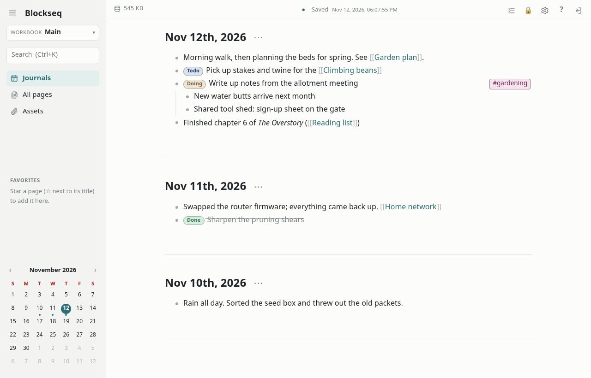
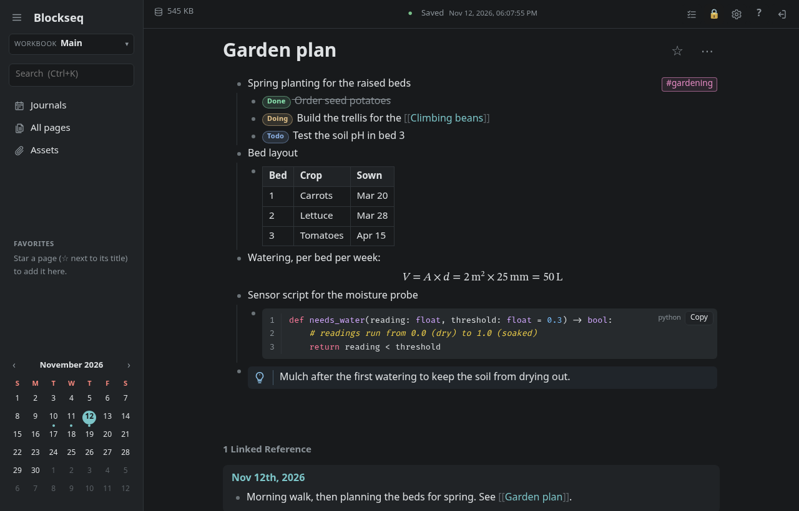
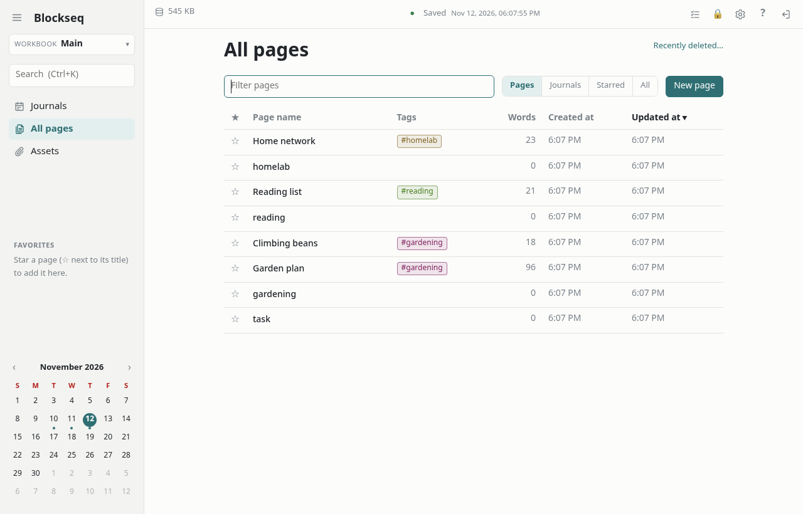

# Blockseq

[](LICENSE)
[](https://www.rust-lang.org)
[](#deploy-on-a-linux-server-or-container)
[](ARCHITECTURE.md)
[](#deploy-on-a-linux-server-or-container)
[](AGENTS.md)

A self-hosted, Logseq-style outliner. Your notes live on your own server (in
SQLite), and you use them from any browser on your network or VPN.

**Inspired by Logseq.** Blockseq owes its ideas to the great work of the
[Logseq](https://logseq.com) project: blocks, journals, page links and the
outliner way of writing. It is a **clean-room implementation**, written from
scratch from observed behaviour and the publicly documented Markdown file
format, without reading Logseq's source code. It contains no code, styles or assets from Logseq (see the provenance
note in [AGENTS.md](AGENTS.md)). It is not affiliated with or endorsed by
Logseq.



- Block outliner: nested bullets, indent and outdent, collapse, move, merge
- Daily journals, `[[page links]]`, `#tags`, `((block refs))`, linked references
- Workbooks: separate sets of notes, each with its own database, Markdown
  files and assets. The workbook menu (click the workbook name) opens,
  creates, renames, deletes (to a trash folder) and imports them, and shows
  where each one is stored on the server
- A header with the save status and last-saved time, the workbook's disk
  usage, and the tasks, lock, settings and help buttons
- Task statuses you define (Backlog, Todo, Doing, In Review, Done, Cancelled),
  colour-coded, with a keyboard-friendly task list in a side pane
- Markdown formatting, code blocks, tables, numbered lists, admonitions (tip,
  note, warning…), quote blocks, LaTeX maths with a maths builder
- `#Encrypted` blocks: their contents are encrypted in your browser; the server
  only stores scrambled text
- Page history: earlier versions of every page, with restore; deleted pages
  can be brought back
- `/` commands, a floating formatting bar, undo/redo, tags at the end of a line
  shown on the right, `#` tag suggestions as you type
- Select whole blocks (keyboard or mouse) to copy, cut, paste, delete or format
  them; Ctrl+B / Ctrl+I for bold and italic
- Code blocks with syntax colours, line numbers and a copy button, plus an
  in-block code editor (current-line highlight, language picker, auto-indent)
- Paste or drop images, PDFs, videos and other files; embedded YouTube, Vimeo
  and X posts. An Assets page lists every file with its path on the server
- Sidebar calendar and favourites
- Autosave, live refresh on other devices, and a side-by-side comparison if
  two devices edit the same page at once
- Every page is also written as a Markdown file, so your notes are never locked
  inside the database
- Backups as one `.zip` per workbook, from the browser or a cron job
- One binary with the web UI built in. No Node or external database.

## Screenshots

| | |
|---|---|
|  |  |
| A page in the dark theme: tasks, a table, LaTeX maths, highlighted code, a tip | The tasks pane: every open task, grouped by page, keyboard-driven |
|  |  |
| Typing `/` opens the command menu; the format bar follows the block | All pages: filter, sort, tags, word counts, starred pages |

The screenshots use made-up notes. To make them again:
`tests/e2e/run.sh screenshots`.

## Run locally

```sh
cargo run --release
# open http://localhost:3030
```

Settings are environment variables (on a server: `/etc/blockseq.env`):

| Variable            | Default        | Meaning                                         |
|---------------------|----------------|-------------------------------------------------|
| `BLOCKSEQ_ADDR`     | `127.0.0.1:3030` | Listen address. Leave this on localhost and do not publish port 3030. A non-local address is refused unless `BLOCKSEQ_PASSWORD` or `BLOCKSEQ_HOSTS` is set, and logs a warning without a password (anyone who reaches the port by IP address gets in) |
| `BLOCKSEQ_DATA`     | `./data`       | Where the workbooks are stored                  |
| `BLOCKSEQ_PASSWORD` | unset          | The password to use Blockseq. Browsers sign in on a page and stay signed in for 90 days after they were last used; **Sign out** is in the header, and Settings → Security can sign out every browser. Scripts send it with HTTP basic auth (any username). Changing it signs every browser out |
| `BLOCKSEQ_MAX_UPLOAD_MB` | `256`      | Largest file you can upload, in MB              |
| `BLOCKSEQ_EXPOSE_PATHS` | unset      | Set to `1` to show full server paths in the browser (Assets, workbooks, the usage tooltip). Unset keeps paths relative to the data folder. A browser on this machine, with no proxy headers, still sees an asset's full path |
| `BLOCKSEQ_HOSTS`    | unset          | Host names to answer to, comma-separated (IP addresses and localhost always work). Blocks "DNS rebinding" by other websites; set it to your HTTPS name, e.g. `notes.example.com` |
| `BLOCKSEQ_TRUSTED_PROXIES` | unset   | Your reverse proxy's IP address(es), comma-separated; the wrong-password limit then sees each real client instead of the proxy |

On start, the log shows how these were read, e.g.
`password: on · host names: notes.example.com · trusted proxies: 10.0.0.1 · server paths: relative`.

## Deploy on a Linux server or container

Blockseq runs well in a small Proxmox LXC, a VM or any Debian/Ubuntu machine.

### Container specs

Blockseq needs very little to run (it idles around 10–20 MB of RAM).
Compiling Rust needs much more, so the size depends on where you build.

| Setting | Build on workstation (recommended) | Build on the server |
|---------|------------------------------------|----------------------|
| OS      | Debian 12/13 or Ubuntu 22.04+ (an unprivileged LXC is fine) | same |
| CPU     | 1 core                             | 2–4 cores            |
| RAM     | 512 MB, 256–512 MB swap            | 2 GB, 1 GB swap      |
| Disk    | 4 GB plus your notes and files     | 10 GB plus your notes and files |

If you build on the server, you can lower CPU and RAM afterwards.

### Option A: build on your workstation (recommended)

The release binary needs glibc 2.34+, so it runs on Debian 12/13 or
Ubuntu 22.04+ without installing anything else.

```sh
# on your workstation
cargo build --release
scp target/release/blockseq root@<server>:/root/
scp -r deploy root@<server>:/root/

# on the server
cd /root && ./deploy/install.sh ./blockseq
```

### Option B: build on the server

Install Rust with rustup. Don't use `apt install rustc`: Debian's packaged
Rust is too old for this project, which needs Rust 1.88+.

```sh
# on the server, as root
apt update && apt install -y build-essential pkg-config curl git rsync
curl --proto '=https' --tlsv1.2 -sSf https://sh.rustup.rs | sh -s -- -y --profile minimal
source ~/.cargo/env

# on your workstation: copy the source, skipping build output and local data
rsync -av --exclude target --exclude data path/to/blockseq root@<server>:/root/

# on the server
cd /root/blockseq
cargo build --release
./deploy/install.sh target/release/blockseq
```

`install.sh` creates a `blockseq` system user, keeps data in
`/var/lib/blockseq`, installs a hardened systemd unit and writes
`/etc/blockseq.env` (only the first time) from `deploy/blockseq.env.example`,
which lists every setting, commented out, with its default; compare an older
env file against it to see settings added since. Check it with
`systemctl status blockseq` and `curl -s http://127.0.0.1:3030/api/health`.

### Upgrading

Rebuild, copy the new binary (or rsync the source and rebuild), then run
`install.sh` again. It first backs up every workbook to
`/var/backups/blockseq/pre-upgrade-<date>/` (the last 10 are kept), then
replaces the binary and keeps your data and `/etc/blockseq.env`. After the
restart it waits up to a minute for `/api/health` to answer and fails, naming
that backup, if the new version does not come up healthy.

## HTTPS with Caddy

Blockseq speaks plain HTTP. Put a reverse proxy such as [Caddy](https://caddyserver.com)
in front for HTTPS; encrypted blocks need it (browsers only allow the
encryption API on secure pages). Caddy can run on the same machine or anywhere
that reaches it (a separate container, a router or firewall with a Caddy
package).

A minimal `Caddyfile`, with Caddy on the same machine as Blockseq:

```
notes.example.com {
    reverse_proxy 127.0.0.1:3030
}
```

- Leave Blockseq on `127.0.0.1:3030`. Do not publish port 3030. Set
  `BLOCKSEQ_PASSWORD` so Blockseq asks for it: you get a sign-in page, sign
  out, and a limit on guessing. (A `basic_auth` on Caddy works too, but a
  browser cannot sign out of it.) With `BLOCKSEQ_TRUSTED_PROXIES` set, the
  sign-in cookie is marked Secure when Caddy says the browser used HTTPS.
- Caddy passes Blockseq's live-update stream (server-sent events) through
  without buffering.
- **Certificates.** For a name reachable from the internet, Caddy gets a
  certificate automatically. For a name that only exists inside your network,
  use the DNS-01 challenge with your DNS provider's Caddy module (Let's Encrypt
  can't reach a private host over HTTP), or Caddy's own internal CA
  (`tls internal`) if your devices trust it.
- **DNS.** Point the name at Caddy (a local DNS override, or a public record).
- **Tell Blockseq about the proxy** in `/etc/blockseq.env`, then
  `systemctl restart blockseq`:

  ```
  BLOCKSEQ_HOSTS=notes.example.com
  BLOCKSEQ_TRUSTED_PROXIES=<Caddy's IP address as Blockseq sees it>
  ```

  To find Caddy's address, open the site through Caddy and run
  `ss -tn state established '( sport = :3030 )'` on the Blockseq server; it's
  the address in the right-hand column (without the port).
- **Restrict who can reach it.** Port 3030 stays on localhost, so Caddy is
  the only door. Put the login on Caddy. Inside your network you can also
  limit the site to your subnets with Caddy's `remote_ip` matcher.

**Over a VPN (e.g. Tailscale or WireGuard):** devices on the VPN reach Caddy
like any other client once the VPN routes to its network and resolves the
name. With Tailscale you can also skip Caddy: `tailscale serve --bg 3030` on
the Blockseq machine gives you `https://<machine>.<tailnet>.ts.net`. (An
unprivileged LXC needs the TUN device for that; add
`lxc.cgroup2.devices.allow: c 10:200 rwm` and
`lxc.mount.entry: /dev/net/tun dev/net/tun none bind,create=file` to
`/etc/pve/lxc/<CTID>.conf`.)

**Built-in protections.** With a password set, each client may try at most 10
different wrong passwords per 15 minutes, then it is refused until that time
is up (repeating the same typo counts once; locked yourself out? wait, or
restart the service). Blockseq refuses changes coming from other websites (a
page you visit can't edit your notes through your browser), sends a
Content-Security-Policy and no-framing headers, and with `BLOCKSEQ_HOSTS` set
only answers to the names you list. `GET /api/health` reports `ok` or `error`
for the settings file and each database (no password needed; it shows no
notes and no file paths), e.g. for Uptime Kuma.

## Your data

`/var/lib/blockseq/` (or `./data` locally) contains:

- `config.json` holds settings shared by all devices (task statuses, the
  locked encryption key, Main's name). It is written safely (never half-written)
  and the previous version is kept as `config.json.bak`. If `config.json` is
  ever damaged, Blockseq uses the `.bak` copy, or refuses to start rather than
  start with empty settings (which would lose the encryption key). Back up
  both, along with your recovery key.
- `workbooks/<name>/` holds every workbook except Main, each with the same
  layout as below; `workbooks/.trash/` holds deleted ones.
- The rest of the folder is the **Main** workbook:
- `blockseq.db` is the SQLite database and the source of truth (including the
  page history).
- `pages/*.md` and `journals/*.md` are Markdown copies of every page, in the
  same outline format Logseq's Markdown graphs use, rewritten on every save
  and on every start. They are a readable copy, not an input: **edits made to
  these files are overwritten**.
- `assets/` holds pasted and uploaded files, linked from blocks as
  ``. Removing an image from a block keeps the
  file, so undo still works; the Assets page shows which files are unused.

**Coming from Logseq?** The simplest way is to copy your notes across (paste
works: pasted outlines keep their structure). Blockseq can also import a
Logseq graph stored as Markdown files (a folder with `pages/` and
`journals/`): copy the folder into `workbooks/`, or zip it and use *Import
backup…*, and it is imported the first time you open it (the original files
are kept in `logseq-original/`). Newer Logseq versions that keep the graph in
a database instead of Markdown files (the "DB version") can't be imported.

### Keeping data safe over time

- **Page history.** Earlier versions of every page are kept: while you edit,
  one every 10 minutes, and always before a big removal, a "Keep mine" in a
  conflict, a restore, a merge or a deletion (up to 100 per page). Open a
  page's **⋯ → History…** to preview a version and **Restore** it; the version
  it replaces is kept too, so a restore can be undone. Deleted pages can be
  brought back from **All pages → Recently deleted…**. Encrypted blocks stay
  encrypted in the history.
- **Saves are checked.** Each save carries the page version it started from;
  a page changed on another device shows a conflict instead of being
  overwritten, and **Show differences** compares their version with yours
  line by line before you choose. Status changes from the task list are
  refused if the task changed meanwhile. Pasting copied blocks never takes
  them away from the page they came from (the copies get new ids). Renaming a
  page or tag is all or nothing.
- **Unsaved changes survive a crash.** While the server can't be reached, the
  browser keeps a copy of your unsaved changes (encrypted blocks stay
  encrypted). If the tab or browser dies, the page offers to restore them the
  next time you open it.
- **Startup checks.** Each workbook's database gets a quick integrity check
  when it opens (the detail is in the log; `/api/health` says `ok` or
  `error`), and temporary files left by an interrupted upload, export or
  import are removed. On shutdown the database files are tidied so they're
  complete on their own.
- **Upgrades back up first** (see Upgrading above).

### Backup and restore

**Settings → Backup → Download backup** saves the workbook you're in as one
`.zip`: a consistent copy of `blockseq.db` (safe while Blockseq is running),
every page and journal as Markdown, all assets, and `config.json`.

**#Encrypted blocks stay encrypted** in the zip. It contains only the
scrambled text plus the *locked* copies of the key from `config.json`, so a
leaked backup reveals no more than the server does, and after a restore your
password (or recovery key) opens the blocks again. Keep the recovery key
somewhere other than next to your backups.

**Import backup…** (Settings → Backup, or the workbook menu) restores a zip
as a **new** workbook; nothing that exists is changed or overwritten.

Or restore it **into Main**, e.g. on a rebuilt server. Nothing is lost
either way:

- If Main holds anything, it is first saved as a zip in
  `/var/lib/blockseq/backups/` (the last 10 are kept; Settings → Backup lists
  them for download, and Import backup restores one).
- Then Main's files move to the trash (`workbooks/.trash/Main <date>`), or,
  if you tick the box, into a workbook you name.
- If anything fails along the way, Main is left as it was. Restored the
  wrong file? Restore the right one into Main the same way.

For encrypted blocks:

- Same server (same password): they just work.
- A server with no password yet: it starts using the backup's password.
- A server with a different password: you're asked for the backup's old
  password (or its recovery key) once, and the browser re-encrypts those
  blocks with your current password. Until then they show "Encrypted with a
  different password"; click that to do it later.

**Automatic backups** from the server, e.g. a nightly cron job that keeps a
zip of every workbook (works while Blockseq is running). Point `--out` at a
NAS or other machine if you can, so a backup survives losing the server:

```sh
blockseq export --all --out /mnt/backups/blockseq
# or one workbook:  blockseq export "Home Lab" --out /mnt/backups/blockseq
```

A nightly job that keeps 30 days, written as a file in `/etc/cron.d/`:

```sh
cat > /etc/cron.d/blockseq-backup <<'EOF'
15 3 * * * root /usr/local/bin/blockseq export --all --out /mnt/backups/blockseq && find /mnt/backups/blockseq -name 'blockseq-*.zip' -mtime +30 -delete
EOF
```

- It runs at 03:15 as root. Use the full path: cron does not read `.bashrc`.
- Old zips are removed only after a successful export (`&&`), so a failed
  night never deletes the backups you have.
- Each day gets its own file (`blockseq-main-2026-11-12.zip`); a second run
  the same day replaces that day's zip.
- The zips are readable by root only (`-rw-------`). A NAS job that collects
  them as another user cannot read them; run it as root or change the
  permissions after the export.
- Now and then, restore one with **Import backup** as a new workbook to prove
  it works, then delete that workbook.

On the server, the commands find `/var/lib/blockseq` themselves; elsewhere
set `BLOCKSEQ_DATA`. Container or VM snapshots are a good second layer.

Treat backup zips (and `/var/backups/blockseq`) like the data folder itself:
they hold every note in plain text except `#Encrypted` blocks, plus the
locked copy of the encryption key. Keep them somewhere only you can read.

## Keyboard

| Key                  | Action                                     |
|----------------------|--------------------------------------------|
| Enter                | New block (splits text at the cursor)      |
| Shift+Enter          | New line inside the block                  |
| Tab / Shift+Tab      | Indent / outdent                           |
| Backspace at start   | Merge with the block above                 |
| Alt+Shift+Up/Down    | Move block among its siblings              |
| Ctrl+Up / Ctrl+Down  | Collapse / expand the block and everything under it |
| Up / Down            | Move between blocks                        |
| Ctrl+Enter           | Next task status (Backlog → … → none)      |
| Ctrl+Z / Ctrl+Shift+Z (or Ctrl+Y) | Undo / redo                   |
| Esc                  | Stop editing (or close the side pane)      |
| ?                    | Shortcut help (when not editing)           |
| t                    | Task list                                  |
| g then e             | Go to the editor (e.g. from the task list) |
| g then l             | Lock / unlock encrypted blocks             |
| Ctrl+B / Ctrl+I      | Bold / italic                              |
| g then j / a / f     | Journals / All pages / Assets              |
| w                    | Switch workbook                            |
| Ctrl+Shift+Enter     | Pick a task status                         |
| Ctrl+\\               | Show / hide the sidebar (or the ☰ button)  |
| `[[` / `((`          | Page / block autocomplete                  |
| `/`                  | Command menu (common commands, then groups; type to search all) |
| Ctrl+K               | Search                                     |

The single-key and `g` shortcuts can be changed in Settings → Keyboard.

**The / menu:** a bare `/` shows a short list: common commands, then groups
(Headings, Admonitions & quote block, Upload & embed, Dates & times, Task
status) that open with **Enter** or **→** (**←** goes back). Typing after the `/`
searches every command, e.g. `/tab` or `/warn`.

**Formatting bar:** while you edit a block, a small bar floats just above it (or
below it when the block is near the top of the window). It has bold, italic,
strikethrough, highlight, inline code, link, page and block references,
headings, and menus for everything else in the / menu (blocks and admonitions,
uploads and video, dates and times), plus task status, the maths builder,
alignment, colour and the block menu. Its menus show each item's / command.
The bar never takes the cursor away; Esc closes an open menu first. Turn it
off in *Settings → Editor → Formatting bar while editing*.

**Code blocks:** type ```` ``` ```` (optionally with a language, e.g. ```` ```bash ````) and
press Tab or Enter, or use `/code`. The code editor opens with the cursor inside.
Click any code block to edit it again. Code blocks longer than 20 lines start
folded, showing their first 6 lines and a *Show all N lines* bar. In
*Settings → Editor* you can turn this off, set how long a block must be to fold,
and set how many lines stay visible while folded. Copy always copies the whole block. Blocks with no language get a guessed
one (shown as "Auto-detect" in the language picker); pick "Plain text" for no
colours. In the code editor:

| Key | Action |
|-----|--------|
| Arrow keys | Move around the code |
| Up on the first line / Down on the last | Move to the block above / below |
| Enter | New line, keeping the indentation |
| Tab / Shift+Tab | Indent / outdent the line (or every selected line) |
| Ctrl+Z / Ctrl+Shift+Z | Undo / redo |
| Esc | Close the editor |

The top-right toolbar has the language picker, Copy, and **Edit as text**, which
edits the whole block including the ```` ``` ```` lines. Use that to add text or a tag
around the code.
Inside a table, Enter adds a row; Enter on an empty row ends the table.
Enter on an empty numbered item ends the list.

Click or right-click a bullet for the block menu: colours, headings (H1–H6, or
auto-sized by depth), text alignment (left / centre / right, stored as a
`text-align:: center` property, which Logseq shows as a plain property), add timestamp (`[[Nov 11th, 2026]] 14:32`, at the cursor
while editing, otherwise at the end of the first line before any tags; also
`/timestamp`, and `/time` for just the time), copy block ref, copy block URL (opens the page scrolled to
that block), copy/export as Markdown or plain text, cut, delete, number list,
and expand/collapse all.

**Images:** paste a screenshot, drag an image onto a block, or use `/image`.
PNG, JPEG, GIF, WebP and AVIF are accepted (checked by file content, not name).
Click an image for a full-size preview. Its ⋮ button offers align
left/center/right, size (fit, original, half, quarter, very small), copy image,
open in new tab, download, and delete. Put two or more images (or PDFs) on the
same line to show them side by side; they shrink together to fit the window.
Clicking one of them opens a viewer with ‹ › arrows (or ← / →) that step
through the images on that line.

**PDFs:** drag a PDF onto a block, paste it, or use `/pdf`. Its ⋮ menu switches
between a link and a full inline preview, and offers open in the side pane, open
in a new tab, download, and remove. Clicking the PDF's name opens it in the side
pane. Files go in the workbook's `assets/` folder.

**Other files:** drop, paste or `/file` any file. Videos (mp4, webm, mkv, mov)
and audio (mp3, m4a, ogg, wav, flac) get a player in the block; put two videos
on one line to show them side by side. Text files (txt, md, csv, json, logs…)
show as a chip that opens in the side pane. Anything else (.doc, .xlsx, .zip…)
shows as a chip that downloads. Every file goes in the workbook's `assets/`
folder. Whether a video plays depends on the browser: mp4 (H.264) and webm
play everywhere; mkv plays in Chrome/Edge when its codecs are supported.
For safety, HTML, SVG and unknown file types are always downloaded rather than
shown, so a file can't run code on your Blockseq address.

**YouTube / Vimeo:** paste a video link on its own and it becomes an embedded
player (stored as `{{video URL}}`, as in Logseq; `&t=42s` start times are kept).
`/video` inserts the same thing. Videos are loaded from youtube-nocookie.com.

**X / Twitter posts:** paste a post link (x.com or twitter.com) on its own and it
becomes an embedded post, stored as `{{tweet URL}}` like Logseq (tracking bits
such as `?s=20` are dropped). It is X's own embed page in a frame, matching the
light or dark theme, with an "Open on X" link under it. An embed shows that one
post (and what it replies to); to keep a whole thread, paste each post you want.

**Assets** (sidebar) lists every file in the workbook's `assets/` folder, with
its path on the server (copy button next to it) and
a thumbnail, size, date and the pages that use it, and buttons to open,
download or delete. *Only unused* finds files no block links to any more.

**Task list by keyboard:** **t** opens the task list with the keyboard in it
(or moves there if it's already open). **↑ ↓** (or **j k**) move, **Space**
(or Ctrl+Enter) sets the next status, **s** (or Ctrl+Shift+Enter) picks one,
**Enter** opens the task with the cursor in it, **g e** goes back to the editor
(a task you change stays in the list for a few seconds even if it no longer
matches, e.g. with no status, so you can keep cycling; the list order never
changes when a status does)
and **Esc** closes the list. **g l** locks or unlocks encrypted blocks.

**Task statuses:** use `/` and the status name, or press **Ctrl+Enter** to step
through the statuses (**Ctrl+Shift+Enter** opens a picker). Click a status badge
to change it. Setting a status adds `#task` to the end of the line (shown on the
right); removing the status removes it. Finished statuses (Done, Cancelled) are
struck out. A block you type as `TODO …` by hand also counts as a task. Define your own statuses (word, label, colour, finished or not) in
*Settings → Tasks*; they are shared by all devices.

**Task list:** the ☑ icon at the top right (or **t**) opens the open tasks in
the side pane, grouped by page. Tick *Show completed* to include finished ones.
Click a task to jump to it, or its badge to change its status.

**Maths (LaTeX):** `\[ … \]` or `$$ … $$` for a centred formula (it may span
several lines), `\( … \)` or `$ … $` inside a sentence. Example:
`\[\text{Percentage Change} = \frac{\text{New Value} - \text{Old Value}}{\text{Old Value}} \times 100\]`.
It is drawn by the browser's built-in MathML, converted by Blockseq's own
`math.js`: fractions, roots, sub/superscripts, Greek letters, operators and
arrows, `\text`, `\sum`/`\int`/`\lim` with limits, `\left…\right`,
accents, `\mathbb` and friends, and `matrix`/`pmatrix`/`bmatrix`/`cases`/
`aligned` environments. Unknown commands show in red. A single `$` needs text
right inside it, so prices like "$5 and $10" stay plain text.

**Maths builder:** `/math` (or clicking any drawn formula) opens a builder that
writes LaTeX and teaches it as you go:

- A palette (structures, operators, relations, Greek, layouts, letters). Each
  button shows the LaTeX it inserts; empty `{}` slots are filled in order with
  Tab. Select some code first and it goes into the first slot (select `a+b`,
  click the fraction: `\frac{a+b}{}`).
- A live preview. Point at any part of the drawn formula to highlight the code
  that made it and get a plain-words explanation; moving the cursor in the
  code highlights the matching part of the drawing. "In this formula" lists
  each construct used, with its explanation.
- Mistakes explained, with one-click fixes: misspelt commands (`\alpah` → did
  you mean `\alpha`?), unbalanced braces, `\left` without `\right`,
  unclosed or mismatched environments, a missing argument, `x^10` (only the 1
  is raised), `e^ix`, `*` for multiplication, `%` (starts a comment), and `&`
  outside a table.
- Centred or in-a-sentence, and a few example formulas to start from.
  `/math` with the cursor inside a formula edits it. Editing keeps the
  delimiters the formula already used. Ctrl+Enter inserts.

**Logseq embeds and macros:** `{{embed [[Page]]}}` shows that page's blocks
and `{{embed ((block id))}}` that block, read-only, with a link to the source
(edit them on their own page). Queries (`{{query …}}`) and other Logseq
macros aren't run; they show as a labelled chip and their text is kept as
written, so Logseq still sees them. Logseq whiteboards aren't supported (a
graph's `whiteboards/` folder is kept in backups but not shown).

**Admonitions:** `/tip`, `/note`, `/important`, `/caution`, `/warning` and
`/pinned` insert a box like Logseq's (stored as `#+BEGIN_TIP … #+END_TIP`).
Enter adds a line inside the box.

**Quotes:** `> text` is a quote line. Put `#quote` on a block (or `/quote block`)
to show it and all its children as a quotation.

**Selecting blocks:** press **Esc** while editing to select that block, then
**Shift+↑/↓** to add blocks (or **Shift+↑/↓** on the first/last line of a block).
You can also drag from one block into another, or Shift+click. With blocks
selected: **Ctrl+C** copies them (with their children) as a Logseq-style
outline, **Ctrl+X** cuts, **Backspace** deletes, **Ctrl+V** pastes after them,
**Ctrl+B / Ctrl+I** formats them, **Ctrl+Enter** changes their status, **Enter**
edits, **Esc** clears. Copied blocks paste back as blocks, in Blockseq or
Logseq.

**Inline code:** `` `text` `` is inline code. Double backticks, ` ``text`` `, add a copy
button next to it.

**Bold and italic:** **Ctrl+B** / **Ctrl+I** wrap the selected text, or the whole
line when nothing is selected (status words and trailing tags stay outside).
On a line with no text yet they insert `****` (or `**`) with the cursor in the
middle, so you can type bold straight away. Press again to undo it.

**Encrypted blocks:** type `/encrypted` (or tag a block `#Encrypted`) and everything nested under it
is encrypted in your browser (AES-256-GCM) before it is saved. The tagged block's
own text stays readable as a label; the server, the database, the Markdown files
and backups only hold scrambled text. Locked blocks show "🔒 Encrypted. Click to
unlock"; one password unlocks every encrypted block in every workbook, and they
lock again after 15 idle minutes (change it in *Settings → Security*), when the
tab closes, or with the 🔓 Lock button. The 🔒/🔓 button at the top right
(next to ?) locks or unlocks them from anywhere. Copying an encrypted block
copies it encrypted. `/encrypted` turns the current block into the label ("Encrypted" if it
was empty), opens a child block for the secret, and asks you to unlock first if
needed. Blocks tagged before a password existed (or while locked)
are still plain text, and say so; they are encrypted as soon as you set the
password or unlock, including on pages you don't have open.

- **Set the password** in *Settings → Security*. You are shown a **recovery key**
  once: save it in a password manager or print it. Without the password *or* the
  recovery key, encrypted blocks cannot be read by anyone, including the server.
- **Change it** in *Settings → Security* (needs the current password).
- The server refuses a key-derivation count above the 600,000 rounds a
  password uses, so a crafted setting cannot stall unlocking or a reset.
- **Forgot it?** Use *Forgot password…* in Settings with the recovery key, or on
  the server:

  ```sh
  ssh -t blockseq 'BLOCKSEQ_DATA=/var/lib/blockseq blockseq reset-encryption-password'
  # (on the server itself, plain `blockseq reset-encryption-password` finds
  # /var/lib/blockseq on its own)
  ```

  It asks for the recovery key and a new password (typing is hidden). Existing
  blocks stay readable. `-t` gives the command a terminal so it can ask
  questions; running it as root is fine, it keeps `config.json` owned by the
  service user.
- Encryption needs **HTTPS** (your Caddy address): browsers only offer it on
  secure pages. Over plain `http://` encrypted blocks stay locked.
- Text inside encrypted blocks is not searchable, and links or tags inside it
  don't create pages. Logseq shows encrypted blocks as scrambled text.

**Renaming pages and tags:** open the page (click a tag to get to its page),
then ⋯ → *Rename…*. Every `#tag`, `#[[tag]]`, `[[link]]` and `tags::` entry in
the workbook is rewritten to the new name. If a page with the new name already
exists, the two are merged (the other page's blocks first). Journals and the
*task* page can't be renamed.

**Tags:** typing `#` suggests existing tags as you type, with *New tag …* first.
Enter puts the chosen tag at the end of the line (shown on the right);
**Ctrl+Enter** keeps it where you typed it. A tag or link page that is empty
and no longer used anywhere is removed automatically (journals and starred
pages are always kept).

**Help:** press **?** (when you're not typing in a block; Esc stops editing) for
the list of shortcuts. Change them in *Settings → Keyboard*. *Copy image*
needs HTTPS (your Caddy address), because browsers block image clipboard
access on plain HTTP.

**Calendar** (bottom of the sidebar): dots mark days with journal entries.
Click a day to open its journal; if none exists, it's created. ‹ › change month,
and clicking the month name returns to today. Hidden on narrow (phone) screens.

**Workbooks:** the box under the Blockseq name shows the workbook you're in;
click it (or press **w**) to switch, or to create, rename, delete or import
one (*New workbook…*, *Rename…*, *Delete…*, *Import backup…*). Each
workbook has its own pages, journals, favorites and assets; task statuses are
shared. Each browser remembers which workbook it was on.

**Journals:** delete a journal from its ⋯ menu (next to the title on the
Journals page, or top right when it's open); this removes it and its Markdown
file from the server. The calendar opens or creates any day.

**Favorites:** click ☆ next to a page title to star it. Starred pages are listed
in the sidebar. They are stored on the server, so every computer shows the same list.

**All pages** is a table of favorite star, page name, tags, word count, created
and updated time (encrypted text isn't counted). Click a star to (un)favorite, or a column heading to sort. The filter
box matches names and tags, and the buttons next to it show Pages (no
journals), Journals, Starred or All. Each browser remembers the last choice.

**Settings** (⚙ in the header), by category:
- *Appearance:* theme (Automatic, Light, Dark, Sepia, Solarized Light/Dark,
  Catppuccin Latte/Mocha, Nord, Gruvbox, Dracula, Tokyo Night), full window
  width, a colour per tag
- *Editor:* open links in a new tab, bullet threading (and showing it all the
  time), syntax colours while editing code, wrapping long code lines, folding
  long code blocks (when to fold, and how many lines to show)
- *Sidebar:* favorites
- *Tasks:* the status list (shared by all devices)
- *Keyboard:* change any global shortcut

Changes in Settings take effect when you click **Apply**. **Undo changes**
throws away what you haven't applied; after an Apply, **Undo last apply** puts
the previous settings back. The search box at the top finds any option,
shortcut or the task statuses. Everything except task statuses is saved per
browser.

Code highlighting is built in, with no third-party library. It covers bash/shell,
ini/conf/toml/systemd, YAML, JSON, Python, JavaScript/TypeScript, Rust, Go,
C-family (C, C++, C#, Java, Kotlin, Swift, PHP), SQL, HTML/XML, CSS, Dockerfile,
diff and Lua. Comments are yellow (*Settings → Editor → Comment colour* can make
them grey). Other languages get basic colouring of comments, strings and numbers.
Pasting a Logseq outline (`- item` lines) creates the matching blocks and keeps
their `id::` values, so block refs carry over.

## License

MIT. See [LICENSE](LICENSE).

Blockseq is a clean-room implementation inspired by Logseq: written from
scratch, with no code, styles or assets from Logseq (which is AGPL-3.0). See
the provenance note in [AGENTS.md](AGENTS.md). Thanks to the Logseq team and
community for the ideas that made this possible.

## How it works

See [ARCHITECTURE.md](ARCHITECTURE.md) for the data model, how saving and
sync work, the API, and where future features would go.

## Not done yet

Zooming into a block, editing inside linked references, unlinked references,
running Logseq queries, whiteboards, and full-text ranking.
