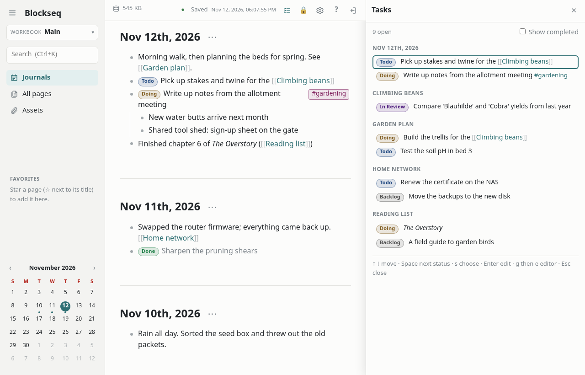
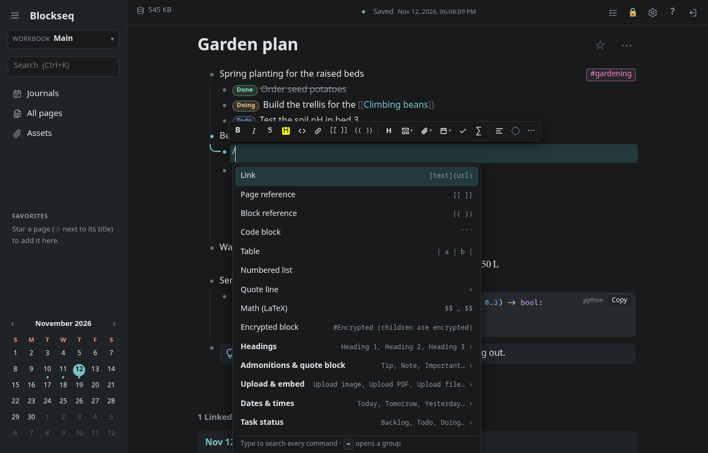

# Blockseq

[](LICENSE)
[](https://www.rust-lang.org)
[](docs/deploy.md)
[](ARCHITECTURE.md)
[](docs/deploy.md)
[](AGENTS.md)

A self-hosted, Logseq-style outliner. Your notes live on your own server, and
you use them from any browser on your network or VPN.


## Features

| | |
|---|---|
| **Outliner** | Nested blocks, journals, `[[links]]`, `#tags`, `((block refs))`, linked references |
| **Writing** | `/` commands, format bar, tables, code with syntax colours, LaTeX maths, admonitions |
| **Tasks** | Your own statuses, colour-coded, with a keyboard-driven task pane |
| **Files** | Paste or drop images, PDFs and videos; YouTube, Vimeo and X embeds |
| **Privacy** | `#Encrypted` blocks are encrypted in your browser; the server only sees scrambled text |
| **Safety** | Page history with restore, conflict check between devices, drafts that survive a crash |
| **Workbooks** | Separate sets of notes, each with its own database, Markdown files and assets |
| **Backups** | One `.zip` per workbook from the browser or cron; restore as new or into Main |
| **Open files** | Every page is also written as Logseq-style Markdown |
| **Small** | One binary with the UI built in; idles at 10–20 MB of RAM |

## Screenshots

| | |
|---|---|
|  |  |
| A page: tasks, table, maths, code, a tip | The tasks pane, grouped by page |
|  |  |
| The `/` menu and the format bar | All pages: filter, sort, tags, word counts |

## Quick start

```sh
cargo run --release      # then open http://localhost:3030
```

On a server (Debian/Ubuntu, a VM or an LXC container):

```sh
cargo build --release
sudo ./deploy/install.sh target/release/blockseq
```

Put [Caddy](https://caddyserver.com) in front for HTTPS and set a password in
`/etc/blockseq.env`. The [deployment guide](docs/deploy.md) has the details.

## Documentation

| Guide | What's in it |
|---|---|
| [Deploying](docs/deploy.md) | Install, upgrade, HTTPS with Caddy, VPN, every setting |
| [Your data and backups](docs/data.md) | Where notes live, safety, backup, restore, nightly cron job |
| [Using Blockseq](docs/usage.md) | Keyboard, formatting, files, tasks, maths, encrypted blocks |
| [Architecture](ARCHITECTURE.md) | Data model, saving and sync, the API |
| [Changelog](CHANGELOG.md) | What changed, by release |
| [Contributing](AGENTS.md) | How to build, test and work on it |

## Inspired by Logseq

Blockseq owes its ideas to the [Logseq](https://logseq.com) project. It is a
**clean-room implementation**: written from scratch from observed behaviour and
the documented Markdown format, with no code, styles or assets from Logseq. It
is not affiliated with or endorsed by Logseq.

**Not done yet:** zooming into a block, editing inside linked references,
unlinked references, Logseq queries, whiteboards.

## License

[MIT](LICENSE)
